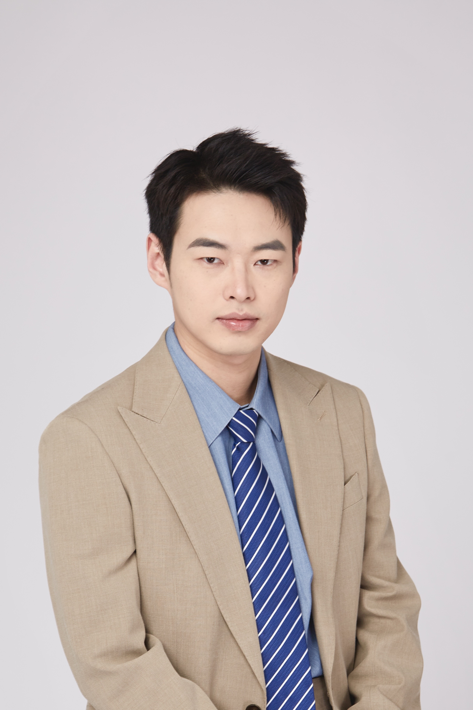

{:.rounded}

Xinze Zhang is a postdoctoral researcher at the Institute of Artificial Intelligence and Optimization, School of Computer Science and Technology, [Huazhong University of Science and Technology (HUST)](http://english.hust.edu.cn/), Wuhan, China. He received a bachelor's degree in accounting from Zhongnan University of Economics and Law in 2015, a Master of Professional Accounting from HUST in 2018, and a Ph.D. in management science and engineering from HUST in 2023. He joined the John Hopcroft Center for Computer Science at HUST as a research assistant in July 2023 and began his postdoctoral research in February 2024.

His research interests include deep learning, sequential data analysis, natural language processing, and time series forecasting. He is principal investigator of projects supported by the China Postdoctoral Science Foundation and the Hubei Provincial Natural Science Foundation of China. He has also participated in National Natural Science Foundation of China projects and State Grid research and consulting projects.
<!-- Most recently, I focus on the adversarial attack for neural machine translation, randomness in deep neural network (DNN), and DNN based time series forecasting models. -->

<h3 style="margin-top: auto;margin-bottom: -10px;">Contact Info</h3>

  

- E-mail: `xinze@hust.edu.cn`, `xinze.zh@outlook.com`

  

  - Wechat: `xinze-zh`

## Publications

`📩 Corresponding author`

`JCR rankings and impact factors are from the year of acceptance`

    2026

- Kun He, Zhenhua Chen, Xin Liu, and <strong data-corresponding-author="true">Xinze Zhang</strong>📩. Dual Generalization Attack: Enhancing Adversarial Transferability through Surrogate Model and Input Feature Generalization. *IEEE Transactions on Emerging Topics in Computational Intelligence*, 2026. Accepted. (JCR Q1, IF 6.0)
- Mingyu Xu, Shiming Deng, Shenghao Qiao, and <strong data-corresponding-author="true">Xinze Zhang</strong>📩. ViDSum-TSF: Long-Document-Driven Multimodal Time Series Forecasting in Edge Intelligence via Visual-Grounded Document Summarization. *Journal of Systems Architecture*, Volume 181, Page 104063, 2026-10-24. [DOI: 10.1016/j.sysarc.2026.104063](https://doi.org/10.1016/j.sysarc.2026.104063){:.publication-doi}. (JCR Q1, IF 5.3)
- Xin Lai, Shiming Deng, Lu Yu, Yumin Lai, Shenghao Qiao, and <strong data-corresponding-author="true">Xinze Zhang</strong>📩. Rethinking Recurrent Neural Networks for Time Series Forecasting: A Reinforced Recurrent Encoder with Prediction-Oriented Proximal Policy Optimization. *Advanced Engineering Informatics*, Volume 76, Part C, Pages 105047, 2026-07-15. [DOI: 10.1016/j.aei.2026.105047](https://doi.org/10.1016/j.aei.2026.105047){:.publication-doi}. (JCR Q1, IF 11.5)
- Qi Sima, Yukun Bao, <strong data-corresponding-author="true">Xinze Zhang</strong>📩, Siyue Yang, and Liang Shen. Reinforced Decoder: Towards Training Recurrent Neural Networks for Time Series Forecasting. *IEEE Transactions on Industrial Informatics*, Volume 22, Issue 6, Pages 5345-5356, 2026-02-20. [DOI: 10.1109/TII.2026.3662462](https://doi.org/10.1109/TII.2026.3662462){:.publication-doi}. (JCR Q1, IF 9.9)
- Renhua Ding, <strong>Xinze Zhang</strong>, Xiao Yang, and Kun He. Feedback-based Modal Mutual Search for Attacking Vision-Language Pre-training Models. *IEEE Transactions on Emerging Topics in Computational Intelligence*, Volume 10, Issue 4, Pages 3121-3134, 2026-05-01. [DOI: 10.1109/TETCI.2026.3683659](https://doi.org/10.1109/TETCI.2026.3683659){:.publication-doi}. (JCR Q1, IF 6.0)

    2025

- <strong data-first-author="true">Xinze Zhang</strong>, Dengao Zhu, Xiyao Dong, and Kun He. Fading-Invariant Adversarial Attacks on Neural Modulation Recognition. In *Proceedings of 2025 IEEE International Conference on Acoustics, Speech and Signal Processing (ICASSP)*, 2025-03-07. [DOI: 10.1109/ICASSP49660.2025.10890846](https://doi.org/10.1109/ICASSP49660.2025.10890846){:.publication-doi}. (CCF B)
- Qi Sima, Yukun Bao, <strong data-corresponding-author="true">Xinze Zhang</strong>📩, Kun He, and Xin Lai. Enhancing Echo State Network with Reservoir State Selection for Time Series Forecasting. *Neurocomputing*, Volume 654, Pages 131283, 2025-08-18. [DOI: 10.1016/j.neucom.2025.131283](https://doi.org/10.1016/j.neucom.2025.131283){:.publication-doi}. (JCR Q1, IF 6.5)
- Qi Sima, <strong>Xinze Zhang</strong>, Siyue Yang, Yukun Bao, and Liang Shen. Multi-scale Fused Graph Convolutional Network for Multi-site Photovoltaic Power Forecasting. *Energy Conversion and Management*, 2025. Volume 333, Pages 119773. [DOI: 10.1016/j.enconman.2025.119773](https://doi.org/10.1016/j.enconman.2025.119773){:.publication-doi}. (JCR Q1, IF 9.9)
- Ganglin Xie, Haobo Lu, <strong>Xinze Zhang</strong>, and Kun He. Advancing SAR Image Robustness: Integrating Diffusion Models for Adversarial Purification and Speckle Noise Suppression. In *Proceedings of 2025 IEEE International Conference on Acoustics, Speech and Signal Processing (ICASSP)*, 2025-03-07. [DOI: 10.1109/ICASSP49660.2025.10888393](https://doi.org/10.1109/ICASSP49660.2025.10888393){:.publication-doi}. (CCF B)

    2024

- <strong data-first-author="true">Xinze Zhang</strong>, Kun He, Qi Sima, and Yukun Bao. Error-Feedback Three-Phase Optimization to Configurable Convolutional Echo State Network for Time Series Forecasting. *Applied Soft Computing*, Volume 161, Pages 111715, 2024-05-09. [DOI: 10.1016/j.asoc.2024.111715](https://doi.org/10.1016/j.asoc.2024.111715){:.publication-doi}. (JCR Q1, IF 7.2)
- Zhenhua Chen, <strong data-first-author="true">Xinze Zhang</strong>, and Kun He. Multi-Channel Convolutional Distilled Transformer for Automatic Modulation Classification. In *Proceedings of the International Joint Conference on Neural Networks (IJCNN)*, 2024-09-09. [DOI: 10.1109/IJCNN60899.2024.10650112](https://doi.org/10.1109/IJCNN60899.2024.10650112){:.publication-doi}. (CCF C)

    2021

- <strong data-first-author="true">Xinze Zhang</strong>, Junzhe Zhang, Zhenhua Chen, and Kun He. Crafting Adversarial Examples for Neural Machine Translation. In *Proceedings of the 59th Annual Meeting of the Association for Computational Linguistics (ACL)*, 2021-08-01. [DOI: 10.18653/v1/2021.acl-long.153](https://doi.org/10.18653/v1/2021.acl-long.153){:.publication-doi}. (CCF A, Oral)
- <strong data-first-author="true">Xinze Zhang</strong>, Kun He, and Yukun Bao. Error-Feedback Stochastic Modeling Strategy for Time Series Forecasting with Convolutional Neural Networks. *Neurocomputing*, Volume 459, Pages 234-248, 2021-10-12. [DOI: 10.1016/j.neucom.2021.06.051](https://doi.org/10.1016/j.neucom.2021.06.051){:.publication-doi}. (JCR Q1, IF 5.7)
- Jianhua Yang, <strong data-corresponding-author="true">Xinze Zhang</strong>📩, and Yukun Bao. Short-Term Load Forecasting of Central China Based on DPSO-LSTM. In *Proceedings of IEEE 4th International Electrical and Energy Conference (CIEEC)*, 2021-08-17. [DOI: 10.1109/CIEEC50170.2021.9510278](https://doi.org/10.1109/CIEEC50170.2021.9510278){:.publication-doi}. (EI-indexed conference)

    2017

- <strong data-first-author="true">Xinze Zhang</strong>, Shuqin Cai, and Siyu Luo. 基于支持向量机的在线负面口碑处理专家识别方法. *统计与决策*, 2017. Issue 490, Pages 80-83. (in Chinese) (CSSCI)

## Preprint

- Ruixian Su, Yukun Bao, and <strong>Xinze Zhang</strong>📩. Temporally Unified Adversarial Perturbations for Time Series Forecasting. [arXiv:2602.11940](https://arxiv.org/abs/2602.11940).

## Research Projects

### Research Grants

- China Postdoctoral Science Foundation: “Trustworthy Forecasting of Distributed Photovoltaic Power Generation Based on Adversarial Learning” (2024M761027), Jan. 2025–Dec. 2026. <b>Principal investigator</b> (13.9% funding rate).
- Hubei Provincial Natural Science Foundation of China: “Adversarial Attack and Defense for Intelligent Signal Modulation Recognition Driven by Physical Information” (2025AFB110), Mar. 2025–Feb. 2027. <b>Principal investigator</b>.
- International Cooperation Foundation of Hubei Province, China: “Key Technologies for Automated Evaluation of Large Models” (2024EHA032), Sep. 2024–Sep. 2026. Participant, ranked second.
- Qiyuan Laboratory Innovation Fund: “Theory and Methods for Evaluating the Security, Fairness, and Trustworthiness of Multimodal Vision-Language Models” (2022-JCJQ-LA-001-069), Jan. 2024–Dec. 2025. Participant, ranked second.
- Hubei Provincial Department of Education: “Digital and Intelligent Curriculum Reform for Animation Design: University–Local Government Collaboration and Local Cultural Practice” (2025144), Jul. 2025–Jul. 2027. Participant, ranked fourth.
- National Natural Science Foundation of China: “Adversarial Attack Technologies for Intelligent Recognition Algorithms in Electromagnetic Space” (U22B2017), Jan. 2023–Dec. 2026. Participant.
- National Natural Science Foundation of China: “Fundamental Theory and Key Technologies for Urban Integrated Energy System Management toward Security, Resilience, and Dual-Carbon Goals” (72242104), Jan. 2023–Dec. 2026. Participant.
- National Natural Science Foundation of China: “Key Algorithms for Adversarial Attacks and Defenses on Deep Models for Natural Language Processing” (62076105), Jan. 2021–Dec. 2024. Participant, ranked third.
- National Natural Science Foundation of China: “Computational Intelligence-Based Forecasting Models in the Big Data Environment and Their Application to Electricity Load Forecasting” (71871101), Jan. 2019–Dec. 2022. Participant, ranked ninth.
- International Cooperation Foundation of Hubei Province, China: “Fundamental Theory and Algorithms for Adversarial Attacks and Defenses on Deep Learning Models” (2021EHB011), Sep. 2021–Sep. 2023. Participant, ranked fourth.

### Industry Projects

- PowerChina Zhixin Energy Technology Co., Ltd.: “Development and Integration of Power Forecasting Algorithms for the Julu Tenghuang Wind Farm and Fugu Huayao Photovoltaic Power Station” (HTGL-ZGS-ZXNYKJYXGS-H-2024-0589), Nov. 2024–Mar. 2026. Participant, ranked third.
- State Grid Corporation of China: “A Unified National Electricity Market with Multilevel Integrated Development and Key Market Operation Issues for the Low-Carbon Transition in Central China” (GHZX2022-3), May–Dec. 2022. Participant, ranked eighth.
- State Grid Corporation of China: “Key Technologies for a Shared Electricity Trading and Services Platform in Central China” (52140019000U), Jul. 2020–Nov. 2021. Participant, ranked tenth.
- State Grid Corporation of China: “Modeling and Benefit Analysis of Southwest Hydropower Trading Volumes Consumed in Central China under Chongqing–Hubei DC Operation” (SGTYHT/18-JS-206), May 2019–Nov. 2020. Participant, ranked tenth.

## Teaching

<b>Machine Learning Experiments (CST0321, 16 hours)</b>

Mar. 2025 - Jun. 2025

Lecturer (16 hours),

School of Computer Science & Technology, HUST

<b>Reinforcement Learning (210131040, 32 hours)</b>

Sep. 2024 - Jan. 2025

Lecturer (8 hours),
with Prof. Kun He (24 hours), School of Computer Science & Technology, HUST

<b>Business Intelligence & Data Mining </b>

Mar. 2019 - Jun. 2020

Teaching Assistant, 

with Prof. Yukun Bao, School of Management, HUST

<b>The Analysis & Design of Management Information System (National Excellent Course)</b>

Mar. 2016 - Sep. 2017

Teaching Assistant,

with Prof. Shuqin Cai, School of Management, HUST

<b>Developing Information System: Methods & Tools (C#)</b>

Sep. 2016 - Jan. 2017

Teaching Assistant,

with Assoc. Prof. Shuangyuan Shi, School of Management, HUST

<b>Data Structure (C/C++)</b>

Sep. 2015 - Jan. 2016

Teaching Assistant,

with Prof. Qianfan Zhang, School of Management, HUST

<b>Database Technology & Application (SQL Server)</b>

Sep. 2015 - Jan. 2016

Teaching Assistant,

with Prof. Qianfan Zhang, School of Management, HUST

## Honors

2023

<b>Outstanding Paper</b>

National Electronic Warfare Conference · Three New Academic Annual Meeting of the State Key Laboratory of Electromagnetic Space Security

Chengdu, China

2022

<b>Second Prize Award</b>

"China Software Cup" College Student Software Design Competition

Nanjing, China

2021

<b>National Scholarship</b>

Huazhong University of Science & Technology

Wuhan, China

<b>Theory & Practice Scholarship</b>

Huazhong University of Science & Technology

Wuhan, China

2017

<b>National Scholarship</b>

Huazhong University of Science & Technology

Wuhan, China

<b>Theory & Practice Scholarship</b>

Huazhong University of Science & Technology

Wuhan, China

2016

<b>Outstanding Graduate </b>

Huazhong University of Science & Technology

Wuhan, China

<b>Outstanding Athlete </b>

National College Wushu Championship

Lanzhou, China

<b>4th Place (Nan Gun)</b>

National College Wushu Championship

Lanzhou, China

<b>6th Place (Nan Quan)</b>

National College Wushu Championship

Lanzhou, China

<b>1st Place (Nan Quan)</b>

Hubei College Wushu Competition

Wuhan, China

2015

<b>3rd Place (Nan Quan)</b>

Hubei College Wushu Competition

Wuhan, China

2014

<b>People's Scholarship</b>

Zhongnan University of Economics & Law

Wuhan, China

<b>6th Place (Nan Quan)</b>

Hubei College Wushu Competition

Wuhan, China

2013

<b>People's Scholarship</b>

Zhongnan University of Economics & Law

Wuhan, China

